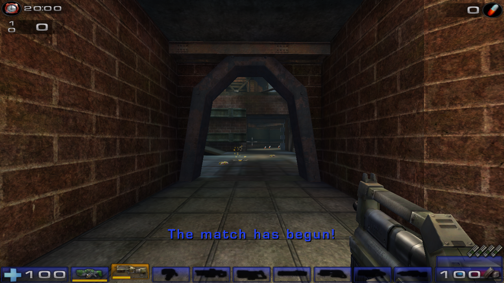
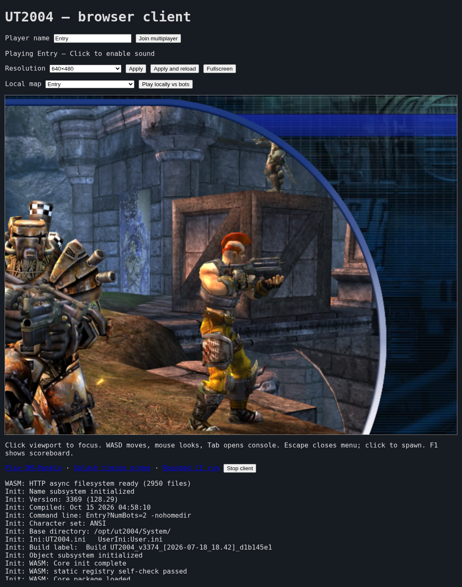
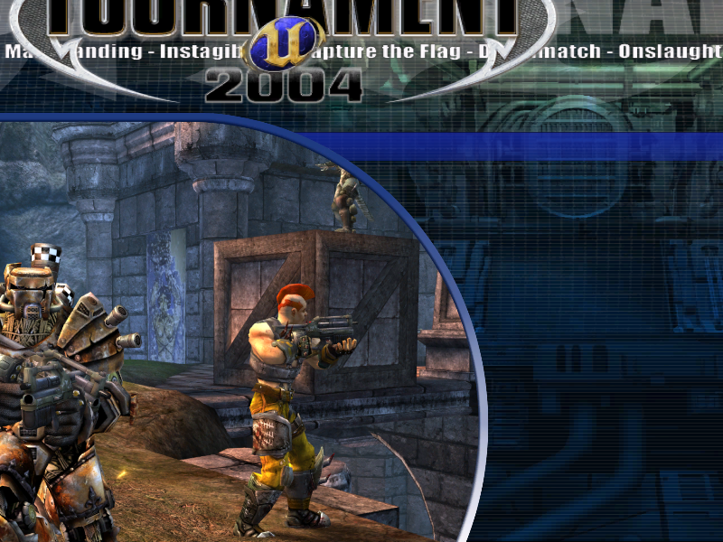

# ut2004-wasm

**Unreal Tournament 2004 in the browser** — a from-scratch [Emscripten](https://emscripten.org/)/WebAssembly port of the UT2004 engine, built from the 2004 source release by way of the community `UT2004_CMAKE` tree. Current release: **v0.2.0** (first public release: v0.1.0).



*DM-Rankin, rendered by the ported engine (SDL3 → OpenGLDrv → GL4ES → WebGL) at a 1280×720 internal canvas in the browser client. Game content © Epic Games — shown running from a privately owned install.*



*The engine's own front-end, live in the browser (v0.2.0): direct `Entry` startup opens the native main menu, and the intro/splash maps (`MOV-*`, `NoIntro`, `NvidiaLogo`) play through and hand off to it. Game content © Epic Games — screenshots from a privately owned install.*



*After `MOV-UT2004-Intro` plays its authored flow, the hand-off target: the same menu. Full evidence set: `docs/phase13-report.md`.*

## ⚠️ You bring the game

This repository contains **no Unreal Tournament 2004 content** — no maps, textures, sounds, music, meshes, or `.u` packages, in the git history, the working tree, or the release binaries. UT2004 belongs to Epic Games and is no longer sold digitally, so to play this port you must **supply your own legally obtained copy** (a retail disc you own, or the community redistribution maintained by [OldUnreal](https://www.oldunreal.com/) under their agreement with Epic). Read [Legal](#legal) before you start.

Built and verified on x86_64 Linux with the two supported data eras: OldUnreal's **3374-preview-23** package set and the final official **3369** release (legacy).

## What works

Status as of **v0.2.0** (2026-10-15, all items verified with real runs):

| Area | State |
| --- | --- |
| Headless Node client | ✅ Boots both data eras to a clean `exit 0` — package mount, class binding, map load, bounded ticks. Full sweeps: **373/373 map runs across both trees reach play, run 600 ticks, and exit 0 — zero native-bind failures**. This is the regression baseline. |
| Browser client | ✅ Full map/mode coverage verified in-browser: a 72-case acceptance across every game mode (DM/TDM/CTF/BR/DOM/AS/ONS/Invasion/Mutant/LMS/tutorials) with real spawn/gameplay evidence; the engine's own front-end (splash, intros, main menu) renders; 0 GL/WebGL/page errors; clean shutdowns. |
| Multiplayer | ✅ Two browser clients joined a native dedicated server through the WebSocket transport, spawned, played, and scored — signon, gameplay, and scoreboard evidence captured from the live deployment. |
| Audio | ✅ ALAudio → Emscripten WebAudio/OpenAL with streamed Vorbis music. Automated acceptance: music queue consumed at ratio 1.0 over a 60 s soak, SFX firing, first-gesture unlock, non-zero analyser signal. *(What's missing: a human listening check — headless Chrome has no audio device, so acceptance proves the signal chain, not the sound.)* |
| Display | ✅ Resolution selector (640×480 / 960×540 / 1280×720, plus `?res=WxH` and persistence), responsive canvas, fullscreen button / `?fullscreen=1`. |
| Input | ✅ Keyboard + mouse with 1:1 relative input (including a no-pointer-lock fallback), bundled touch/controller kit for mobile. |
| Map coverage | ✅ Every map in both data trees boots, loads and plays (headless and browser; see `docs/phase13-report.md`). A handful of community add-on maps carry authored-data errors — documented, not hidden. The shell ships a 242-map picker. |
| Server features | ✅ The reference deployment runs with map travel (no crash), xVoting enabled, and auto-admin for every joining player. |
| Gamma/brightness | ⚠️ No software gamma; maps render at their native lighting in the browser. |

Observed on the live deployment (headless Chrome): DM-Rankin first frame **118.7 s cold / 65.4 s warm**, both at zero GL/WebGL/page errors. These are measurements, not guarantees — startup is dominated by the single ~22 MB wasm image plus ranged package reads.

## Try it

### The fast path (prebuilt)

1. Grab `ut2004-web-v0.2.0.tar.gz` from the releases page and extract it.
2. Provision game data into a directory of your own:

   ```bash
   scripts/install-game-data.sh --dest ./data3374
   ```

   The installer downloads **only from OldUnreal's Epic-approved sources** (their installer's ISO links and their pinned patch releases), verifies size and sha256, and never re-hosts or bundles a byte of game content. It needs `curl`, `7z`, `unshield`, `sha256sum`, `tar`, `bzip2`, runs as a non-root user, and is idempotent (a rerun/resume left all 2,721 file hashes unchanged in testing). A licensed final **3369** install also works as a legacy data root.

3. Serve it. The client reads packages over HTTP **byte ranges** and expects `.wasm` as `application/wasm`; `serve-dist.py` handles both, including brotli sidecars:

   ```bash
   python3 scripts/web-manifest.py --data ./data3374 --output ./ut2004-web
   python3 scripts/serve-dist.py --web ./ut2004-web --data ./data3374
   # → http://127.0.0.1:8080/ut2004/
   ```

   …or point any web server at the same layout (`/ut2004/` for the client, `/ut2004/data/` for the data tree, `/assets/` for the mobile kit). A minimal Caddy equivalent is in the build-from-source section below.

4. Open the page and pick a map — or join multiplayer with `?interactive=1&connect=1&name=You`.

### Build from source

Prerequisites: x86_64 Linux, Docker, Node.js ≥ 22, `brotli`, Python 3, ~10 GB free disk.

```bash
# 1. Fetch the pinned community engine tree + GL4ES and apply the 26-patch port series.
scripts/setup-sources.sh

# 2. Provision game data (approved ISO + pinned 3374 patch). No sudo.
scripts/install-game-data.sh --dest ./data3374

# 3. Browser client → build/web/  (+ build/assets/ for the mobile kit)
UT2004_DATA="$PWD/data3374" ./link-web.sh

# 4. Headless Node client → build/ut2004.js
./link-em.sh
npm ci

# 5. Boot the engine headlessly against your data
UT2004_BASE="$PWD/data3374/System" node build/ut2004.js
```

Expected Node boot milestones:

```text
Init: WASM: Core init complete
Init: WASM: Core package loaded
Init: WASM: Engine package loaded
Log: Browse: NvidiaLogo.ut2?…
Init: LoadMap: NvidiaLogo.ut2?…
Init: Unreal engine initialized
Log: Game class is 'CinematicGame'
Init: WASM: bounded loop complete
WASM: clean exit
```

`WASM_SKIP_GC=1` exists as a diagnostic escape hatch only — leave it unset for real verification. `--mount-only` stops after the data mount.

Minimal Caddy layout for a deployment (byte ranges are default; the brotli sidecar is picked up automatically):

```caddyfile
example.com {
    root * /srv/site          # /srv/site/{ut2004/,assets/}
    @wasm path /ut2004/*.wasm
    header @wasm Content-Type application/wasm
    file_server {
        precompressed br gzip
    }
}
```

A user-provided legacy install works too: build with `UT2004_DATA="$PWD/data3369/UT2004" ./link-web.sh` and boot with `UT2004_BASE="$PWD/data3369/UT2004/System" node build/ut2004.js`.

## Multiplayer

The browser client is a real network client: the ported IpDrv sends each UDP datagram as one binary WebSocket message, and a small relay unwraps them back to UDP in front of a native dedicated server.

```text
[browser client: ut2004.wasm]
   SDL3 · OpenGLDrv → GL4ES → WebGL · IpDrv → one WS message == one UDP datagram
        │
        │  wss://<host>/ut2004/connect2   (TLS terminated by your web front)
        ▼
[ws ⇄ UDP relay]   components/relay/relay.js   (node; one UDP socket per connection)
        │
        │  UDP 7777 (dev) · 7797 (persistent)
        ▼
[native UT2004 dedicated server]   ucc-bin server
```

Run your own relay:

```bash
RELAY_PORT=8080 UDP_TARGET_HOST=<server-host> UDP_TARGET_PORT=7797 node components/relay/relay.js
```

Then join with `?interactive=1&connect=1&name=<you>`, or point the page at a different relay with `?ws_url=wss://your-host/your/connect2`. Server-side map/voting/admin notes (including the xVoting config requirement) are in `docs/phase8-report.md`.

## Controls

Click the viewport to focus, then: **WASD** move · **mouse** look · **left/right mouse** fire · **Space** jump · **Tab** console · **F1** scoreboard · **Escape** menu. On touch devices the bundled controller kit drives the same inputs; desktop gamepads map through the same layer. `?interactive=1` starts interactive, `?bounded=1` runs the six-tick CI mode, `?map=DM-Rankin` boots a specific map directly.

## How it works

- **One wasm image, nothing embedded.** The engine compiles to a single ~22 MB wasm (≈4.8 MB brotli). Game packages are fetched from *your* HTTP server at runtime — config files up front, packages lazily via byte ranges (`wasi_snapshot_preview1.fd_read` under Asyncify).
- **Renderer**: the engine's own OpenGLDrv, with SDL3 (built from the tree) and GL4ES translating GL to WebGL2/ES2.
- **The GC fix that mattered most**: the engine's recursive `FArchiveTagUsed` mark walk overflows the JS/wasm stack at ~2,629 depth on valid graphs. Under Emscripten it is replaced with an iterative worklist that produces identical marks (50,971 entries compared byte-identical). Native recursion is untouched.
- **3374 support**: 49 runtime native entries implemented plus 4 existing-native signature extensions and cross-era layout handling, so the same client runs both the 3374-preview-23 and final 3369 package sets. The 26-patch series applied to the pinned tree reconstructs the verified engine tree byte-identically.

```text
build-em.sh   per-module emcc harness        link-em.sh  → headless Node client
link-web.sh   → browser client (build/web/)  web/        shell, mobile kit, pre.js, HTTP library
patches/      the 26-patch source series     components/relay/  ws ⇄ UDP relay
scripts/      CDP + HTTP harnesses, data/install/serve scripts    docs/  port reports & RE notes
```

Heavy directories (`src/`, `data3369/`, `build/`, `node_modules/`) are git-ignored and provisioned locally.

## Known limitations

- **Data eras**: verified against final official **3369** and OldUnreal **3374-preview-23** only. Arbitrary later community package sets are not claimed; use the supported versions (`install-game-data.sh` provisions 3374-preview-23).
- **Audio**: signal-verified by automated acceptance; a physical listening check is still outstanding.
- **Coverage**: all maps in both supported data trees now boot, load and play; the remaining known issues are authored-data errors in a few community add-on maps plus documented quirks (`docs/phase13-report.md`). Nothing is hidden behind no-op stubs.
- **Startup time**: cold first frame is tens of seconds. Full-file prefetch was tried and *regressed* startup — the ranged read path is intentional. A real progress bar needs a relink with `INCOMING_MODULE_JS_API` extended for `wasmBinary` (documented in `docs/phase7-report.md`).
- **Browser support**: desktop Chromium tested (including iGPU); WebGL1/ES2-class hardware required.

## Legal

- This repository and its release binaries contain **no UT2004 game data or assets**. Everything copyrightable belongs to its owners.
- **Unreal Tournament 2004 is © Epic Games, Inc.** It has been delisted from digital stores. To play this port you must **source your own legal copy** — a retail CD/DVD you own, a store copy you already own, or the official community redistribution maintained by OldUnreal (which distributes installers under an agreement with Epic Games).
- The engine **source tree is not distributed here** either. `scripts/setup-sources.sh` fetches a pinned commit of the community `UT2004_CMAKE` tree and applies this project's patch series to it — the patches, not the tree, are what this repository stores.
- The **MIT `LICENSE` covers the original code in this repository only** (build/link harnesses, browser shell, relay, test harnesses, docs). It grants no rights over Epic Games' engine or game content, nor over anything fetched by `setup-sources.sh` (GL4ES is MIT; SDL/zlib/Vorbis come from the fetched tree under their own licenses — see `NOTICE.md`).
- This is a personal engineering project: not affiliated with, endorsed by, or supported by Epic Games or OldUnreal.

## Credits

**[OldUnreal](https://www.oldunreal.com/)** — the UT2004 patch lineage and the community game distribution that makes provisioning possible. **[emmanuelgoldstein1337/UT2004_CMAKE](https://github.com/emmanuelgoldstein1337/UT2004_CMAKE)** — the community source tree this port's patches apply to. **[ptitSeb/gl4es](https://github.com/ptitSeb/gl4es)** — GL→WebGL translation. **SDL3 · zlib · Emscripten** — platform, compression, toolchain. The rtcw/q3 browser ports — the same WebSocket⇄UDP transport pattern, proven first there.

## Documentation

The `docs/` directory carries the engineering trail: phase reports (`phase2c` → `phase13`), `CHANGES-wasm-port.md` (every source change), and the reverse-engineering groundwork (`toolchain-and-method.md`, `re-modules.md`, `swap-points.md`, `linkage-notes.txt`). The 26-patch series is described in `patches/README.md`.
